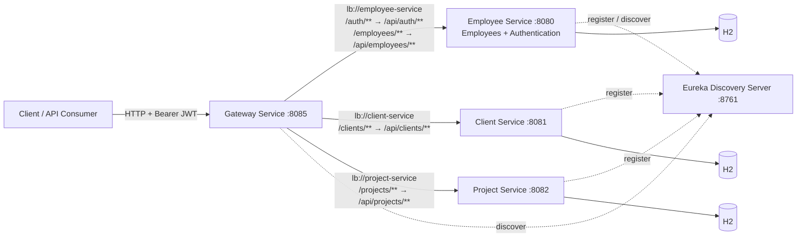

# Enterprise Business Operations Platform

A Java and Spring Boot microservices platform for managing employees, clients,
and projects. An API gateway provides a single entry point, JWT authentication
protects business APIs, and Netflix Eureka provides service discovery.

> **Current implementation:** Authentication endpoints are part of
> `employee-service` and registered with Eureka as `employee-service`. The
> platform does not yet have a separate auth microservice.

## Features

- **Employee management** — CRUD endpoints, employee profiles, departments,
  managers, and employee status.
- **Client management** — CRUD endpoints and unique client email addresses.
- **Project management** — CRUD endpoints, client and manager references,
  budgets, lifecycle status, and date-range validation.
- **JWT authentication** — Registration, login, and authenticated profile
  endpoint; BCrypt password hashing and CEO, MANAGER, and EMPLOYEE roles.
- **API gateway** — Common entry point with JWT validation, request logging,
  path rewriting, and structured gateway errors.
- **Service discovery** — Eureka registry for service registration and
  gateway load-balanced routing.
- **API documentation** — Swagger UI for the Employee, Client, and Project
  services.

## Architecture



Services own independent in-memory H2 databases. `clientId` and
`projectManagerId` in Project Service are external identifiers; they are not
cross-service database relationships. Data is reset when each service stops.

## Technology Stack

| Area | Technologies |
|---|---|
| Language | Java 21 |
| Application framework | Spring Boot 3, Spring MVC / WebFlux |
| Service communication | Spring Cloud Gateway, Netflix Eureka, Spring Cloud LoadBalancer |
| Persistence | Spring Data JPA, H2 |
| Security | Spring Security 6, JWT (JJWT in Employee Service; OAuth2 Resource Server at the gateway), BCrypt |
| API contracts | Jakarta Bean Validation, Swagger / OpenAPI |
| Build | Maven |
| Supporting libraries | Lombok, MapStruct |

## Project Structure

```text
.
├── pom.xml                         # Employee Service (includes authentication)
├── src/                            # Employee and Auth APIs
├── client-service/                 # Client CRUD microservice
├── project-service/                # Project CRUD microservice
├── gateway-service/                # API gateway and JWT validation
└── discovery-server/               # Netflix Eureka server
```

Each service directory contains its own `pom.xml`, source, configuration, and
tests, and can be built and started independently.

## Prerequisites

- JDK 21
- Maven 3.8+
- PowerShell (examples below use Windows PowerShell)

Verify the tools are available:

```powershell
java -version
mvn -version
```

## Setup and Run

Open a separate PowerShell terminal for each service. Start Eureka first, then
the application services, and start the gateway after its upstreams are up.

### 1. Start service discovery

```powershell
cd D:\AnbuselviWorkplace\discovery-server
mvn spring-boot:run
```

Eureka dashboard: <http://localhost:8761>

### 2. Set the shared JWT signing key

Use the **same** Base64-encoded key for Employee Service and Gateway Service.
Generate a random 256-bit key once in PowerShell, then copy the printed value
into both terminals:

```powershell
$bytes = New-Object byte[] 32
$rng = [System.Security.Cryptography.RandomNumberGenerator]::Create()
$rng.GetBytes($bytes)
$jwtSecret = [Convert]::ToBase64String($bytes)
$rng.Dispose()
$jwtSecret
```

Do not commit the key or use the example output as a permanent production
secret.

### 3. Start Employee Service

In the Employee Service terminal, set the shared key and run:

```powershell
cd D:\AnbuselviWorkplace
$env:JWT_SECRET = '<paste-generated-base64-key>'
mvn spring-boot:run
```

This service runs on port `8080` by default and hosts both `/api/employees/**`
and `/api/auth/**`.

### 4. Start Client and Project services

Run these in separate terminals:

```powershell
cd D:\AnbuselviWorkplace\client-service
mvn spring-boot:run
```

```powershell
cd D:\AnbuselviWorkplace\project-service
mvn spring-boot:run
```

Client Service defaults to port `8081`; Project Service defaults to `8082`.
Both register with Eureka at `http://localhost:8761/eureka/`.

### 5. Start the API Gateway

In another terminal, set the **same** JWT key and start the gateway:

```powershell
cd D:\AnbuselviWorkplace\gateway-service
$env:JWT_SECRET = '<paste-generated-base64-key>'
mvn spring-boot:run
```

The gateway listens on port `8085`. Override service ports with `SERVER_PORT`;
override the Eureka endpoint with `EUREKA_SERVER_URL`. Gateway upstreams can be
overridden with `AUTH_SERVICE_URI`, `EMPLOYEE_SERVICE_URI`, `CLIENT_SERVICE_URI`,
and `PROJECT_SERVICE_URI`. Defaults use Eureka service IDs.

## API Reference

| Operation | Gateway endpoint | Upstream endpoint | Access |
|---|---|---|---|
| Register | `POST /auth/register` | `POST /api/auth/register` | Public; always assigns EMPLOYEE |
| Login | `POST /auth/login` | `POST /api/auth/login` | Public |
| Current user | `GET /auth/me` | `GET /api/auth/me` | Bearer token |
| List employees | `GET /employees` | `GET /api/employees` | Any role |
| Create employee | `POST /employees` | `POST /api/employees` | MANAGER or CEO |
| Employee by ID | `GET /employees/{id}` | `GET /api/employees/{id}` | Any role |
| Update employee | `PUT /employees/{id}` | `PUT /api/employees/{id}` | MANAGER or CEO |
| Delete employee | `DELETE /employees/{id}` | `DELETE /api/employees/{id}` | MANAGER or CEO |
| Client CRUD | `/clients/**` | `/api/clients/**` | Bearer token |
| Project CRUD | `/projects/**` | `/api/projects/**` | Bearer token |

The gateway validates token signature, expiry, and issuer before forwarding
protected requests. Role checks for Employee APIs are enforced by Employee
Service. Public registration cannot create MANAGER or CEO accounts; those roles
must be assigned through a trusted administrative process.

## API Examples

Examples use the gateway at `http://localhost:8085`.

### Register and capture a token

```powershell
$registration = @{
    username = "jane.doe"
    email = "jane.doe@example.com"
    password = "Use-a-strong-password-123"
} | ConvertTo-Json

$auth = Invoke-RestMethod `
    -Uri "http://localhost:8085/auth/register" `
    -Method Post `
    -ContentType "application/json" `
    -Body $registration

$token = $auth.accessToken
$headers = @{ Authorization = "Bearer $token" }
```

For an existing account, call `POST /auth/login` with `username` and `password`
instead.

### Get the authenticated user

```powershell
Invoke-RestMethod `
    -Uri "http://localhost:8085/auth/me" `
    -Headers $headers
```

### Read employees

```powershell
Invoke-RestMethod `
    -Uri "http://localhost:8085/employees" `
    -Headers $headers
```

### Create a client

```powershell
$client = @{
    clientName = "Acme Corporation"
    industry = "Technology"
    contactPerson = "Alex Smith"
    email = "alex@acme.example"
    phoneNumber = "+1-555-0100"
    country = "United States"
    status = "ACTIVE"
} | ConvertTo-Json

Invoke-RestMethod `
    -Uri "http://localhost:8085/clients" `
    -Method Post `
    -Headers $headers `
    -ContentType "application/json" `
    -Body $client
```

### Create a project

```powershell
$project = @{
    projectCode = "PRJ-100"
    projectName = "Platform Modernization"
    clientId = 1
    projectManagerId = 2
    startDate = "2025-01-01"
    endDate = "2025-12-31"
    budget = 250000.00
    projectStatus = "PLANNED"
    description = "Modernize the operations platform."
} | ConvertTo-Json

Invoke-RestMethod `
    -Uri "http://localhost:8085/projects" `
    -Method Post `
    -Headers $headers `
    -ContentType "application/json" `
    -Body $project
```

Project statuses are `PLANNED`, `ACTIVE`, `COMPLETED`, and `ON_HOLD`.

## API Documentation

When the corresponding service is running:

- Employee and Auth: <http://localhost:8080/swagger-ui.html>
- Client: <http://localhost:8081/swagger-ui.html>
- Project: <http://localhost:8082/swagger-ui.html>
- Eureka Dashboard: <http://localhost:8761>

## Build and Test

Run Maven from each independent service directory:

```powershell
mvn test
```

The Employee Service uses the repository-root `pom.xml`. Other projects use
their own `pom.xml` under `client-service`, `project-service`,
`gateway-service`, or `discovery-server`.

## Future Roadmap

- Extract authentication into a dedicated Auth Service.
- Move H2 databases to production-grade persistent databases and add schema
  migrations with Flyway or Liquibase.
- Add centralized configuration, secrets management, and environment-specific
  deployment profiles.
- Add distributed tracing, metrics, health dashboards, and alerting.
- Add pagination, filtering, and sorting to collection endpoints.
- Add service-to-service client and manager ID verification.
- Add container images, Docker Compose, and Kubernetes deployment manifests.
- Expand automated contract, authorization, and end-to-end testing.
